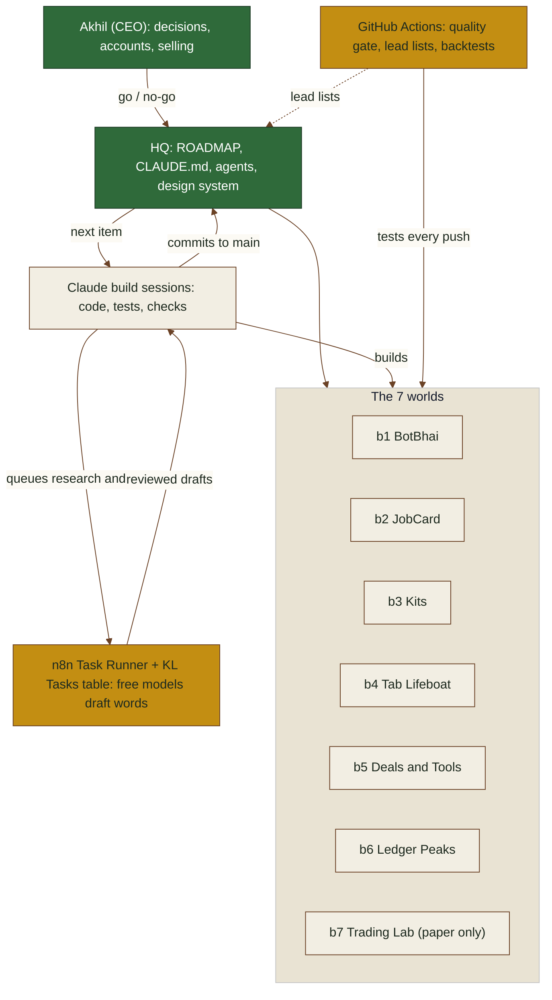

# Kalpa Labs architecture (one page)

Made with `.claude/skills/diagrams/SKILL.md` (A77, 22 Oct 2026). It answers one question: what talks to what.

- Akhil decides; nothing goes public until he says "go" (CLAUDE.md rule 9).
- HQ holds the plan and rules; Claude sessions take the next roadmap item, build it with tests and push to `main`.
- Word work (research, drafts, translations) goes to the n8n Task Runner on free models (`00-hq/DELEGATE.md`); GitHub Actions runs every world's tests and the lead lists.
