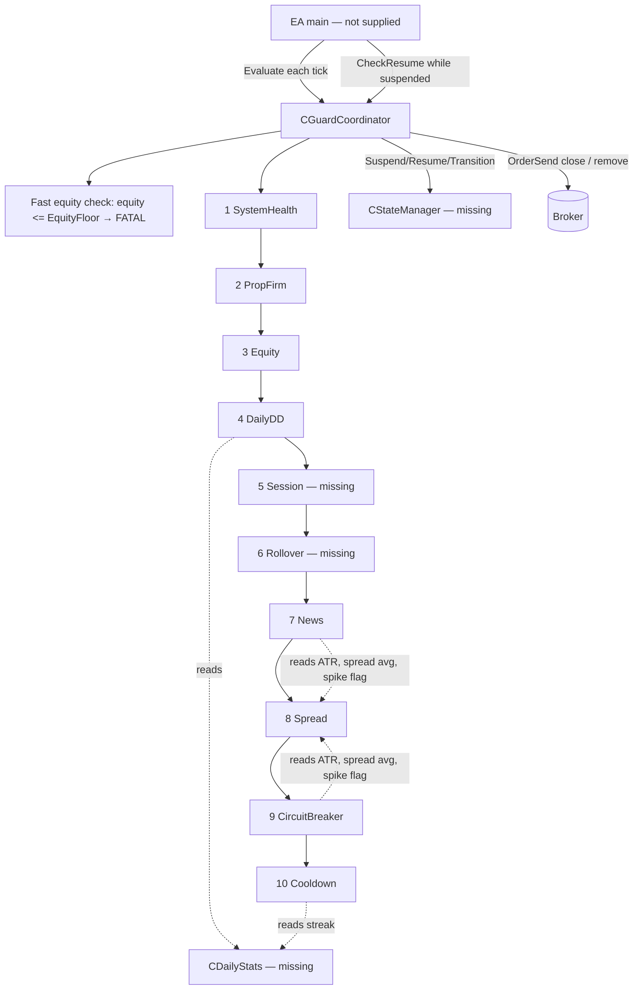

# Audit · XAUUSD EA guard / risk layer (10 MQL5 files) · 21 Nov 2026

Source: Akhil's upload `Quantitative_EA_Guard_Modules_Agent_Prompt.md` (4,300 lines). The 10 files were extracted
verbatim into `07-trading/ea/mql5/Guards/` and every line count matches the prompt. Line numbers below are file
line numbers. **Not compiled:** there is no MetaEditor here, so compile questions are marked "verify in MetaEditor".

---

## A. Source inventory and coverage

| File | Lines | What the code does |
|---|---|---|
| CDailyDrawdownGuard.mqh | 175 | Slot 4. Reads `CDailyStats`: daily loss limit, max trades, losing-streak pause → SUSPEND; post-trade cooldown → BLOCK |
| CSystemHealthCheck.mqh | 453 | Slot 1. Fatal checks at Init (symbol, permissions, netting, config); every 5 s connectivity; every 30 s price sanity, timer, test file write |
| CGuardCoordinator.mqh | 794 | Runs slots 1–10 in order and stops at the first non-PASS; fast equity check; acts on SUSPEND/FATAL; closes positions; resume routing |
| GuardTypes.mqh | 645 | Enums, `GuardContext`, `GuardEvalResult`, result builders, `PopulateGuardContext`, `IGuard` base, suspend descriptor table |
| CCooldownManager.mqh | 292 | Slot 10. Adaptive post-trade cooldown with jitter, post-news cooldown, file persistence (BLOCK only) |
| CSpreadGuard.mqh | 478 | Slot 8. Hard cap / calibrated spread threshold, spike tracking, real-RR gate, ATR store used by News and CB |
| CCircuitBreaker.mqh | 319 | Slot 9. M5 range ATR buffer; triggers on ATR spike, 3 expanding bars, price velocity → SUSPEND with cooldown |
| CNewsGuard.mqh | 357 | Slot 7. No calendar: detects news after the fact from ATR + spread spike + velocity (2 of 3) → SUSPEND, then post buffer BLOCK |
| CPropFirmGuard.mqh | 346 | Slot 2. Equity floor → permanent lock file + FATAL; profit target → terminal; logs multiple positions / pending orders / one-sidedness |
| CEquityGuard.mqh | 198 | Slot 3. Tiers at floor + 700 / 400 / 200: warn / 50 % size / close + SUSPEND |

All 4,057 lines were read. **Not supplied** (so not audited): `Defines.mqh`, `PriceUtils.mqh`, `CLogger`, `CConfig`,
`CDailyStats`, `CStateManager`, `CTimerSystem`, `CPersistence`, the Session (slot 5) and Rollover (slot 6) guards,
the EA main file (`OnTick`, `OnTimer`, `OnTradeTransaction`), and the entry/trade managers.

## B. Architecture (only edges visible in the code)

- **Who changes state:** only the coordinator calls `StateManager` (Suspend, Resume, Transition). Guards keep their own
  internal state and change it inside `Evaluate()`, even though `IGuard` says Evaluate must not change state
  (GuardTypes 455–460). News, CB, Cooldown, Spread and Equity all do.
- **Order:** manual suspend → slots 1..10; the first non-PASS result is returned and acted on. PASS results only
  pass on `size_reduced` / `size_multiplier` (Coordinator 161–170).
- **Throttle:** a full chain runs at most every 200 ms. In between, the cached result is returned (611–615). The fast
  equity check runs on every call, before the throttle (596–608).
- **Resume:** while suspended, the coordinator asks only the guard mapped to the reason, through `CheckResume()`
  (662–719). It does not call `Evaluate()`.

## C. Per-file findings (source order; the full list is in E)

**CDailyDrawdownGuard.** D1–D3 → SUSPEND, D4 → BLOCK (66–144). The limits live in `CDailyStats`, which wasn't supplied,
so it's unknown whether the daily loss includes floating P&L (the log on line 73 prints `GetClosedPnL()`). Resume
depends on `CDailyStats` rolling over while the EA is suspended; the call site isn't visible. D4 repeats the cooldown
that slot 10 also enforces (F-M5).

**CSystemHealthCheck.** Fatal checks run only in `Init()` (319–322), so permissions removed later aren't caught.
`TERMINAL_TRADE_ALLOWED` and `MQL_TRADE_ALLOWED` are never checked; only the account flags are (146–147). The price
band is 1,000–5,000 (37–38), but gold closed at $5,318 on 29 Jan 2026 (F-H5). The price-sanity BLOCK fires only on
the one evaluation when the 30 s cache expires (388–403); every other evaluation passes (fail-open). The test file
is still written every 30 s (411); hardening item MEDIUM-5 was not applied.

**CGuardCoordinator.** Critical-3 of the hardening report can't be checked (the EA main file isn't here), and `Init()`
returns true even when slots 1–2 are missing (571). The close paths have no filling mode, reuse a stale price on
retry, accept only `TRADE_RETCODE_DONE`, and use a blocking `Sleep(2000)` (340–381, 437–463). Only the first
matching position is closed (328). Once suspended for a reason, a failed close is never retried (233–238). PASS
results carrying `cancel_pending` are ignored (161–170). The fast equity check pre-empts PropFirmGuard (598).

**GuardTypes.** `RecordTrigger` adds to `eval_count` again after `RecordEval` (504, 515), so counts are doubled.
The tier comments say "within 5 % / 7 % of floor" (265–267), but the code uses $700 / $400 / $200.
`DeterministicRand`, used by Cooldown, isn't defined in any supplied file.

**CCooldownManager.** Jitter is "seeded … looks human" (44–63); see F-M9. Nothing in these files calls
`OnTradeClosed` or `OnNewsCleared` (278). `Evaluate()` writes to disk (193, 223), which breaks the "no I/O in
Evaluate" rule. Loaded values aren't validated (negative cooldown, for example).

**CSpreadGuard.** Once calibrated, the threshold can reach 1.5× the hard cap (117–122). The header promises a
"7-day rolling" store (17), but samples never expire (403). `OnTimerSample` (389) has no caller in these files, and
it's the only place `m_last_atr_m5` is set (416), so News and CB depend on unseen timer code. `line[0]` (213):
verify string indexing in MetaEditor.

**CCircuitBreaker.** CB3 (velocity, 288) sits in an `else if` after CB2, whose condition `m_range_count >= 3 && atr > 0`
(269) is true in normal running, so CB3 never runs (F-H1). `CheckResume` returns `m_state == CB_NORMAL` (312), but
the state only goes back to NORMAL inside `Evaluate()` (224) (F-H3). "5-condition reset" (245, 304): the code checks
3 conditions plus 2 confirming evaluations. The "longest cooldown" branch in `Trigger` (100) can't run, because
Trigger is only called in NORMAL state.

**CNewsGuard.** There's no economic calendar, so it can't block before scheduled news. The Phase 1 design's rule
"no setup within 60 min of major news" isn't implemented. The velocity buffer is refreshed on every evaluation
(226), so 4 slots cover about 0.8 s, not "30-second intervals" (39). The newest slot is the current price itself
(F-H2). It reads the spread spike flag from slot 8, which runs after it (293), so the value is one evaluation old
or older. `CheckResume` returns false for ACTIVE (348–354), and only `Evaluate()` moves to POST_COOLDOWN (236, 245)
(F-H3). `extern CSpreadGuard SpreadGuard;` (28) is unused: verify in MetaEditor.

**CPropFirmGuard.** The floor lock is written to disk (191–211), but only if this guard runs, and the coordinator's
fast check returns first (F-H7). Multiple positions are only logged; the comment says "coordinator will close",
but no such code exists (254–264). `cancel_pending` on a PASS result is ignored (287; F-H6). The firm's real daily
loss rule isn't implemented (F-H8). `ManualReset=true` left in the inputs clears the lock on every restart (140).
`CheckResume` (315–332) can't be reached, because the lock returns FATAL.

**CEquityGuard.** Tier 3 = floor + $200 = $9,300 (80). It closes and suspends (109–128); resume needs equity above
$9,300 (192), which can't happen without trading (F-H4). The header and the unused `EQ_TIER*_BUFFER` defines (27–29)
disagree with `Init()`. Hysteresis applies only on the way back to NORMAL (171).

## D. Cross-module integration

- **GuardTypes contracts:** results and enums are used consistently. `SUSPEND_EQUITY_FLOOR`, `SUSPEND_DISCONNECT` and
  `SUSPEND_PERF_CRITICAL` are never produced. `SUSPEND_SPREAD_HIGH`, `SESSION_CLOSED` and `ROLLOVER` come from
  slots 5–6, which weren't supplied.
- **Order effects:** the chain stops at the first non-PASS, so a block in slots 1–6 (for example out-of-session)
  means News, Spread and CB never run. Their buffers (M5 ranges, spread spike, price history) go stale and
  restart with gaps at the session open.
- **Daily DD vs Equity:** DailyDD (closed P&L, presumably) and Equity tiers (live equity) aren't linked. Neither
  implements The5%ers' 5 % daily rule (based on the previous day's balance or equity, including floating P&L).
- **CB vs Cooldown:** independent. CB suspends; Cooldown only blocks.
- **Spread units:** everything is in "pips" from `PriceUtils.PipSize()`, which wasn't supplied. Slippage
  `SlippageMax*10` assumes 10 points per pip, which means pip = $0.10 on a 0.01-point gold symbol. The design's
  ATR and stop numbers only make sense if pip = $1. That has to be fixed in one place.
- **News time/currency:** none; detection is behaviour-only.
- **Persistence:** CB, News, Cooldown, Spread and the PropFirm lock persist; Equity tier, `m_target_reached` and the
  long/short counts don't.
- **Duplicated authority:** two cooldowns (DailyDD D4 and slot 10), two equity floors (the coordinator fast check and
  PropFirm P1), and two news cooldowns (News POST buffer and Cooldown post-news, the second with no caller).

## E. Findings register

| ID | Sev | Type | File:lines | Evidence | Failure scenario | Impact | Fix (smallest) | Test |
|---|---|---|---|---|---|---|---|---|
| C1 | Critical | Potential (needs EA main) | Coordinator 586–650, 662–719 | Equity floor and Tier-3 close run only in `Evaluate()`; while suspended, only `CheckResume()` runs | News/CB suspend with a trade open → floating loss grows → no fast check, no Tier-3 close; only the server-side SL protects | Floor breach if the SL fails or gaps | Run the fast equity check (and Tier 3 when a position is open) at the top of `CheckResume()` too | Suspend for NEWS with an open position, drop equity below the floor, and expect a FATAL plus close within 1 tick |
| C2 | Critical | Confirmed + broker check | Coordinator 340–381, 437–463, 233–238 | No `type_filling`; price not refreshed between retries; only `DONE` counts; after the SUSPEND transition the duplicate check `break`s, so a failed close is never retried | Broker needs IOC → retcode 10030 three times → EA suspended with the position still open | Unmanaged losing position | Set filling from `SYMBOL_FILLING_MODE`; refresh the bid/ask each attempt; accept `DONE_PARTIAL` and re-close the rest; retry closes on every call while `close_required` and a position exists | Mock `OrderSend` returning 10030, then 10004, then 10009: expect the retry to succeed and the state to stay correct |
| C3 | High | Confirmed | Coordinator 321–333 | `break` after the first matching ticket | 2 positions (P3 detects this) → only one closed by Tier-3 / profit target | Remaining exposure | Loop over all matching tickets (reuse `EmergencyCloseAll`) | 2 positions + Tier-3 → both closed |
| H1 | High | Confirmed | CircuitBreaker 269, 288 | CB3 is in an `else if` after a branch that is always taken | A $15 move in 60 s on calm bars → no trigger | Velocity protection missing | Make CB3 a separate `if`, not `else if` | Feed 3 normal bars + a velocity jump → CB_PRICE_VELOCITY |
| H2 | High | Confirmed | News 39, 101–119, 226 | Buffer updated every evaluation (~200 ms); the newest slot is the current price | Fast spike over 2 min isn't seen; reset check is always "clear" | News detection relies on the other 2 triggers only | Sample the price every 30 s (time-gated), check before updating | Price series with a 2-min jump → N3 fires |
| H3 | High | Confirmed (given the coordinator contract) | CB 224, 312; News 236–245, 348–354; Coordinator 662–719 | State only clears inside `Evaluate()`; resume asks `CheckResume()` | Any CB or news trigger → EA suspended until restart | No trading for days; The5%ers' 30-day inactivity rule | Let `CheckResume()` call the same reset logic as `Evaluate()` (or the coordinator calls `Evaluate()` for the suspending guard) | Trigger CB, advance past the cooldown with calm data, call CheckResume → resumes |
| H4 | High | Confirmed | Equity 80, 109–128, 192 | Tier 3 at $9,300 closes and suspends; resume needs equity > $9,300 with no position | First −7 % day → EA never trades again (restart doesn't help) | Challenge stops at −7 % while the firm allows −10 % | Decide on purpose: make Tier 3 a day-long pause, or resume on next-day balance; set the descriptor to match | Balance $9,290, no position → expect the documented behaviour |
| H5 | High | Confirmed | Health 37–38, 255–270, 388–403, 444 | Max price 5,000; gold reached $5,318 (29 Jan 2026). BLOCK only on the 30 s-cache tick | Gold > 5,000 → intermittent blocks and resume refused; a bad tick passes 99 % of evaluations | Wrong blocking either way | Use a band relative to the last good price (e.g. ±20 %) and cache the result for the whole 30 s | Bid 5,200 → pass; bid 0.5× last → block for every evaluation in 30 s |
| H6 | High | Confirmed | PropFirm 254–288; Coordinator 161–170 | `cancel_pending` on a PASS result is dropped; "coordinator will close excess" has no code | A stray pending order or 2nd position stays | Bulk-trading rule breach risk | Act on `cancel_pending` / close-excess flags for PASS results too | Pending order present → removed next evaluation |
| H7 | Medium | Confirmed | Coordinator 596–608; PropFirm 140, 191–211 | The fast check returns before slot 2, so the lock file isn't written; ManualReset left true clears it every start | Floor touched, equity then above the floor, restart → trades again | Self-protection bypass | Write the lock in the fast check too; ignore ManualReset unless a reset token/date matches | Equity ≤ floor once → restart → still locked |
| H8 | High | Design risk / missing | PropFirm (absent); DailyDD 66–83 | The5%ers High Stakes: 5 % daily loss on max(previous day balance, equity), floating included | Gap/slippage on an open trade breaches 5 % with the own 3 % limit counting closed P&L only | Account termination | Add a live daily-equity check against the firm formula in slot 2 | Prev-day equity 10,200 → floating −520 → block/close before −510 |
| H9 | Medium | Confirmed | Coordinator 541–572 | `Init()` returns true with slots 1–2 missing | Wiring mistake → EA trades without health or prop guards | Fail-open | Return false when `critical_ok` is false | Init with slot 2 empty → INIT_FAILED |
| M1 | Medium | Confirmed | Spread 117–122 | Calibrated threshold capped at 1.5× hard cap | Spread 35 pips allowed after calibration | Costlier entries than the 25-pip design rule | `MathMin(threshold, SpreadHardCap)` | Calibrated p95 30 → threshold ≤ 25 |
| M2 | Medium | Confirmed | Spread 17, 389–420 | No expiry, despite the "7-day rolling" claim | Old high-spread regime keeps thresholds loose | Wrong thresholds | Decay sums daily (×6/7) or keep 7 day-buckets | 8-day-old samples ignored |
| M3 | Medium | Confirmed design | Coordinator 155–186; News 293 | Chain stops early; News reads Spread state from the previous run | Stale spike flag/buffers at session open | Late or missed detection | Update detector buffers every tick before the chain, or move Spread before News | Out-of-session block, then open: buffers continuous |
| M4 | Medium | Missing evidence | Spread 389, 416; Cooldown 260, 278; PropFirm 337; Spread 452 | No call sites for `OnTimerSample`, `OnTradeClosed`, `OnNewsCleared`, `RecordTradeDirection`, `SetPendingRRCheck` | If not wired: no calibration, News ATR trigger dead (`GetLastATR()=0`), no cooldown, no RR gate | Silent loss of protections | Show the EA main/timer code; add asserts in Init that the timer has fired | Run 2 min → samples > 0 |
| M5 | Medium | Confirmed design | DailyDD 126–144; Cooldown 179–243 | Two cooldowns with different lengths | Confusing blocks; tests disagree | Ops risk | Keep one (slot 10) | — |
| M6 | Medium | Potential | Coordinator 354, 451; all "pips" | Pip size undefined across modules | 10× wrong slippage/spread/velocity limits | Wrong gates | Define `pip_size` once and derive `points_per_pip` | Unit test for both pip conventions |
| M7 | Medium | Potential | Coordinator 611–615; Spread 356–373 | A cached result skips Stage 3 RR | RR gate never evaluated for a fast entry | Bad-RR entries | Call `InvalidateCache()` after `SetPendingRRCheck` | — |
| M8 | Low | Confirmed | Health 411 | File write every 30 s (hardening MEDIUM-5) | VPS I/O | Minor | Cache the result 5 min | — |
| M9 | Low | Recommendation | Cooldown 44–63 | "looks human" jitter | Harder to test; The5%ers allows EAs, so disguise isn't needed | — | Fixed, deterministic cooldown | — |
| L1–L8 | Low | Confirmed | GuardTypes 504/515; Equity 27–29, header; GuardTypes 265; Coordinator 205, 537, ~673; CB 100, 245; News `NEWS_COOLDOWN` | Double counting; stale comments; BLOCK de-dupe by reason NONE; NULL deref in `RegisterGuard`; reminder log only when age % 600 == 0; dead branches | Logging/diagnostics only | — | Tidy up | — |
| I1 | Info | Verify in MetaEditor | News 28; CB 127; Cooldown 95; Spread 213; Cooldown 60 | `extern` object; private `LoadState` overriding a public virtual; string indexing; `DeterministicRand` not defined here | Possible compile errors/warnings | — | Compile with `#property strict` | Compile log clean |

## F. Risk-control behaviour matrix

| Guard | Activates when | Result | Clears when | Fail mode | Blocks entries | Manages open trade | Missing data |
|---|---|---|---|---|---|---|---|
| Fast equity | equity ≤ EquityFloor | FATAL + close all | never (restart) | closed | yes | close (single try per position) | equity read live |
| 1 Health | fatal flags / 2 disconnect checks / bad price | FATAL / SUSPEND / BLOCK | reconnect + price in band | price check mostly open (H5) | yes | no | timer/persistence degraded only |
| 2 PropFirm | lock, floor, target | FATAL / terminal | ManualReset restart | closed for lock | yes | close on floor/target | pending/excess not acted on (H6) |
| 3 Equity | ≤ floor+200 / +400 / +700 | SUSPEND+close / 50 % / log | equity > floor+200 (unreachable, H4) | closed | yes | close at Tier 3 | — |
| 4 DailyDD | `CDailyStats` flags | SUSPEND / BLOCK | `CDailyStats` rollover | not established | yes | no | `CDailyStats` not supplied |
| 7 News | 2 of {ATR, spread spike, velocity} | SUSPEND → BLOCK | Evaluate-only (H3) | detection weak (H2, M4) | yes | no | no SpreadGuard → never resets |
| 8 Spread | spread > threshold; RR < min | BLOCK | spread ≤ threshold | closed on a 0 pip size? (spread = 0 passes) | yes | no | uncalibrated → hard cap |
| 9 CB | ATR spike / 3 expanding bars (velocity dead, H1) | SUSPEND | Evaluate-only (H3) | — | yes | no | ATR fallback 15 |
| 10 Cooldown | after `OnTradeClosed` / `OnNewsCleared` | BLOCK | time | open if never called | yes | no | callers not supplied |

## G. Numbers re-derived

- **Equity tiers** (Init 78–82), with EquityFloor = 9,100: Tier 3 ≤ 9,300, Tier 2 ≤ 9,500, Tier 1 ≤ 9,800, all
  inclusive (`<=`). The header (9,500/9,300/9,200) and defines (500/700/900) are both wrong.
- **Fast check / P1:** `equity <= 9,100` (inclusive). The5%ers' real floor is 9,000 (10 % of 10K), so the buffer is $100.
- **Spread threshold** = max(10, min(1.3 × p95, 1.5 × HardCap)); p95 ≈ mean + 1.65 σ, capped at the max seen. With
  HardCap 25, the calibrated threshold can be up to 37.5 (M1).
- **Real RR** = (TP2 − spread)/(SL + spread). Example (hypothetical): SL 30, TP2 75, spread 3 → 72/33 = 2.18.
- **Cooldown** = 900 (+300 after 1 loss, +600 after 2) ± 20 % jitter, minimum 60 s. Overflow in `DeterministicRand`
  can't be checked; the function wasn't supplied.
- **Throttle:** `GetMicrosecondCount()` delta / 1000 ≥ 200. Wrap-around after ~584,000 years: fine.
- **Floating-point:** all thresholds are direct double comparisons; no epsilon is needed at these magnitudes.
- **DST/time:** sessions use `TimeGMT()`. In the Strategy Tester, `TimeGMT()` equals the server time, so session
  logic is shifted in backtests unless the offset is handled (not visible here).

## H. Production scenarios (what the code does)

1. **Daily loss hit:** DailyDD → SUSPEND_DAILY_LIMIT; resume depends on `CDailyStats` rolling over during suspension (not visible).
2. **Equity breach with a trade open:** fast check → FATAL → `EmergencyCloseAll` (one try per position) → STATE_FATAL_ERROR.
   No lock file (H7). A failed close is retried only if `Evaluate()` keeps being called in FATAL state (unknown).
3. **Spread widens / gap:** BLOCK while spread > threshold; an open trade isn't touched.
4. **CB trips:** SUSPEND; stays suspended until restart (H3); restart clears it if `resume_time` has passed.
5. **Cooldown expires:** clears on the next `Evaluate`.
6. **News feed missing:** no feed exists. If `OnTimerSample` isn't wired, the ATR trigger is dead.
7. **Restart:** CB/News/Cooldown/Spread/lock restored; Equity Tier 3 recomputed from equity (still stuck if ≤ 9,300).
8. **Disconnect:** 1st check degraded (pass), 2nd failed → SUSPEND; resume on reconnect plus a sane price (> 5,000 blocks, H5).
9. **Conflicting guards:** the first non-PASS wins; a later guard's need (e.g. PropFirm `cancel_pending`) is lost.
10. **Order rejection:** 3 tries, stale price, no filling mode (C2); then a critical log only.

## I. Test plan (highest first)

1. C1: suspended (NEWS) + open trade + equity → 9,099. Expect: close + FATAL on the next tick.
2. C2: mock `OrderSend` returning 10030 / 10004 / 10010 partial / 10009. Expect: filling chosen from the symbol,
   price refreshed, partial remainder closed, retry continues after the SUSPEND transition.
3. H3: CB trigger, then 20 min of calm M5 bars and normal spread, call `CheckResume` only. Expect resume (fails today).
4. H1: 3 normal bars, then the bid moves `CBVelocityPips` in 90 s. Expect CB_PRICE_VELOCITY (fails today).
5. H2: News price series with a 2-minute jump ≥ `CBVelocityPips`. Expect N3 (fails today).
6. H4: balance 9,290, no position, next day. Expect the documented behaviour (today: suspended forever).
7. H5: bid 5,200 → pass; bid 520 → block on every evaluation for 30 s.
8. H6: one pending order with our magic → removed within 1 evaluation; 2 positions → excess closed.
9. H7: equity 9,100 then a rebound to 9,400 → restart → still locked; ManualReset with a stale token → still locked.
10. H8: firm daily formula, at 4.99 % / exactly 5.00 % / 5.01 % daily loss including floating P&L.
11. Boundaries: equity 9,300.00 / 9,300.01 (Tier 3 `<=`); spread = threshold (passes, `>` check); cooldown end second.
12. Time: London open 07:00 GMT across the March/October DST changes; tester `TimeGMT()` offset.
13. Restart: kill the terminal during CB active / news active / cooldown; check each file is restored and expired states clear.
14. Compile with `#property strict` in MetaEditor (I1).

## J. Missing evidence

EA main file (`OnInit` registration order, `OnTick` state switch, `OnTimer`, `OnTradeTransaction`); `CDailyStats`
(closed vs floating P&L, rollover call site); `CStateManager` (allowed transitions incl. SUSPENDED → PROFIT_TARGET);
`PriceUtils.PipSize()`; `CConfig` values (EquityFloor, ProfitTarget, DailyLossLimit, SpreadHardCap, CB multipliers,
SlippageMax); Session and Rollover guards; `Defines.mqh` (`DeterministicRand`, `SPREAD_SPIKE_RATIO`,
`CB_ATR_BARS`, enums); the entry engine and trade manager (callers of `SetPendingRRCheck`, `OnTradeClosed`,
`RecordTradeDirection`); a broker symbol spec (filling modes, point, contract size).

## Hardening report (Phase 2.5) — status in this code

| Item | Status |
|---|---|
| CRITICAL-1 SaveState recursion | Fixed: CB uses `WriteCBStateToDisk`, Cooldown uses `WriteCooldownStateToDisk` |
| CRITICAL-2 profit target terminal | Fixed in coordinator (220–229); `CStateManager` transition rule not supplied |
| CRITICAL-3 Init before RegisterGuard | Can't check (EA main not supplied); `Init()` still returns true anyway (H9) |
| HIGH-1 include CStateManager | Fixed (DailyDD line 22) |
| HIGH-2 MathSrand | Cooldown fixed; Session guard not supplied; `DeterministicRand` not supplied |
| HIGH-3 equity tier defaults | Fixed (Equity 59–61, 97–105) |
| HIGH-4 FILE_TXT | Fixed (Spread 155) |
| HIGH-5 split files | Fixed (CCircuitBreaker.mqh separate) |
| MEDIUM-1 const_cast | Fixed (`GetSessionHour` is const) |
| MEDIUM-3 ClearLockFile check | Not applied, but fails closed (the lock stays if delete fails) |
| MEDIUM-5 persistence every 30 s | Not applied (M8) |

## K. Verdict

- **Source-level correctness:** not yet. Three confirmed logic defects disable protections (H1, H2, H3), and the
  close path is fragile (C2, C3). Not compiled.
- **Cross-module integration:** incomplete. PASS-result flags are dropped (H6); detector state starves (M3); five
  callbacks have no visible caller (M4).
- **Operational resilience:** weak. Any CB/news trigger halts trading until restart (H3), and Tier 3 stops the EA
  for good at −7 % (H4).
- **Risk-control completeness:** the firm's 5 % daily rule is missing (H8). Equity protection while suspended is
  unproven (C1).
- **Demo testing:** possible after C2, H1–H3 and H5 are fixed and the code compiles.
- **Controlled live testing:** blocked until C1, C2, C3, H3, H4, H6, H8 are fixed, there are tests for items 1–10
  of section I, and a demo run of ≥ 30 trades shows no guard misfires. No claim of "institutional-grade",
  "prop-compliant" or "profitable" is supported by this code alone; the strategy itself tested at about break-even
  (see `07-trading/research/ea-design-gold-2026-11-21.md`).
