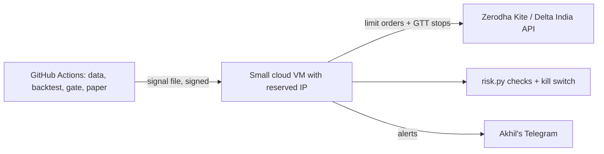

# A153: Real-money trading bot for Akhil's own money (India, Nov 2026)

Research agent, 9 Nov 2026. Builds on `README.md`, `PLAN.md` §2a/§2b/§5a and `research/deep-scan-v2.md`. This is engineering and legal research. It is not investment advice and it does not promise any profit. Facts marked **UNVERIFIED** were not confirmed by two independent sources today.

## Summary: the recommended path (10 lines)

1. **First venue: NSE ETFs (Nifty, gold, Nasdaq-100 and liquid ETFs) bought with delivery through a broker API.** The law here is the clearest: SEBI's own-algo route, ordinary capital-gains tax, and losses can be set off.
2. **The law allows it today.** Under SEBI's 4 Feb 2025 circular (fully in force since 1 Apr 2026), a self-built algo for your own money below 10 orders per second needs **no exchange registration**. It needs a broker API key, a **whitelisted static IP** for orders, and a daily 2FA login.
3. **Broker:** Zerodha Kite Connect "Personal" (free for orders) with the MIT `pykiteconnect` SDK. Free alternatives that include data are Fyers, Angel One SmartAPI and ICICI Breeze.
4. **Strategy 1:** time-series trend plus volatility targeting on 3–4 ETFs, rebalanced weekly with limit orders, and a broker-side GTT stop on every holding.
5. **Second venue (crypto, 24/7): Delta Exchange India**, which is FIU-registered, settles in INR, and offers an API with a free testnet. Strategy 2 is BTC/ETH trend at **1× leverage only**. Run it on the testnet first.
6. **Forex is mostly closed for a bot.** Offshore forex apps break FEMA (95 names are on the RBI alert list). LRS money can't be used for forex margin. NSE rupee pairs now need a real hedging exposure.
7. **Funding-rate carry is parked** until a CA confirms how crypto futures are taxed. If the futures leg falls under the 30% no-set-off rule, the tax alone can wipe out the carry.
8. **Hosting:** GitHub Actions can't place live orders because it has no fixed IP. Use one small cloud VM with a reserved IP. Research, backtests and the gate stay on Actions.
9. **Risk rules:** the existing `src/risk.py` limits (0.5% risk per trade, 1% daily loss stop, 10% drawdown kill), plus a kill-switch file and Telegram alerts. Every order runs through the gate's paper record first.
10. **Akhil's steps (about 60 min, on a PC):** open or enable the broker account, create the API app, buy or allocate a static IP, put the keys in GitHub/VM secrets himself (never in chat), and sign `capital-rules.md`.

---

## 1. India law: a resident running his own algo

| Rule | What it says | Status today | Sources |
|---|---|---|---|
| Base circular | SEBI/HO/MIRSD/MIRSD-PoD/P/CIR/2025/0000013, 4 Feb 2025, "Safer participation of retail investors in Algorithmic trading" | Verified | S1, S2 |
| Full implementation date | Moved from 1 Aug 2025 to 1 Oct 2025, then a glide path. **Full implementation for all brokers from 1 Apr 2026** (SEBI/HO/MIRSD/MIRSD-PoD/P/CIR/2025/132, 30 Sep 2025) | Verified | S3, S4, S5 |
| Access only through a registered broker | Brokers are the principal. "No open APIs." Access needs a client-specific API key and a **static IP whitelisted by the broker** | Verified | S2, S5, S6 |
| Self-built algo threshold | A self-built algo must be registered with the exchange (through the broker) **only if it crosses the order-per-second threshold**. NSE set the threshold at **10 orders/second per exchange per segment** | Verified | S2, S6, S7, S8 |
| Below threshold (our case) | No registration. Orders get a **generic algo ID** from the broker. Only one API key per user may run an unregistered algo | Verified (generic ID and one-key rule: Zerodha only, **UNVERIFIED** second source) | S6, S7 |
| Family use | A registered self-built algo may be used for "self, spouse, dependent children and dependent parents", never for other people | Verified (circular text via mirror) | S2 |
| Static IP scope | Needed for **order actions only** (place, modify, cancel, GTT). Holdings, positions and historical data calls are not restricted. One primary and one backup IP. The IP can be changed once a week | Verified | S5, S7, S8 |
| Daily login | 2FA/OAuth is compulsory. Fyers says 2FA once every trading day, with no endless refresh tokens. Brokers enforce daily auto-logout | Verified | S5, S9 |
| Order types | Fyers converts market orders to "market price protection" orders. Angel One says market and IOC orders are not allowed for algos. **Plan: limit orders only** | Verified (two brokers, slightly different wording) | S5, S8 |
| Foreign IP | Zerodha says there is no rule that the IP must be Indian, and IPv6 is allowed | **UNVERIFIED** (Zerodha only) | S6 |
| Selling the algo to others | Needs exchange empanelment as an algo provider, and RA registration for black-box algos. **Out of scope** (PLAN §2c) | Already in PLAN | PLAN.md |

**What this means for b7:** a weekly ETF bot sends a few orders a week, far below 10 per second, so it is legal with no registration. It must run from a fixed IP. Someone must complete 2FA once on each trading day the bot needs a session. A weekly rebalance therefore means **one login a week**, and broker-held GTT stop orders protect the holdings on the other days.

## 2. Forex: what an Indian resident may legally trade

| Route | Legal for Akhil? | Practical for a bot? | Sources |
|---|---|---|---|
| Offshore forex/CFD apps (MT4/MT5 brokers, eToro, Pepperstone, XM, OctaFX, etc.) | **No.** Residents may deal forex only with authorised persons, on RBI-authorised ETPs or on NSE/BSE/MSE. Unauthorised ETPs bring action under FEMA. The RBI alert list had **95 names** after 7 were added in Nov 2025 | Never | S10, S11, S12 |
| Sending LRS money abroad for forex trading or margin | **No.** The RBI LRS FAQ lists "remittance for trading in foreign exchange abroad" and margin calls to overseas exchanges as prohibited | Never | S13, S11 |
| NSE/BSE rupee pairs (USDINR, EURINR, GBPINR, JPYINR) | Only with a **real underlying foreign-currency exposure**: hedging, not speculation. In force since 3 May 2024. Below USD 100 million a declaration is enough, but the exposure must exist | No, unless Akhil earns or owes foreign currency (for example, export income in dollars) | S14, S15, S16 |
| NSE cross pairs (EURUSD, GBPUSD, USDJPY; lot 1,000 units) | Listed on the exchange. Whether the exposure rule also covers them: **UNVERIFIED** | Weak: users report almost no open interest, and Fyers has turned the segment off | S17, S18 |
| Legal "global macro" substitute | NSE equity-segment ETFs that follow gold, US indices (Nasdaq-100, S&P 500) and liquid funds. They are bought like shares, not forex | **Yes.** This is how currency and global trend exposure enters Strategy 1 | Our design |

**Verdict:** there is no legal way to run a speculative forex bot in India. We take dollar and gold exposure through NSE ETFs. If Akhil ever has real foreign-currency income, rupee-pair hedging becomes possible.

## 3. Crypto

**Legal status:** crypto is not banned and not regulated as a security. VDA service providers must register with FIU-IND under PMLA. FIU-IND issued notices to 15 unregistered offshore platforms on 9 Sep 2026 (S19, S20, S21).

**Tax:**

| Item | Rule | Status |
|---|---|---|
| Gains on transfer of a VDA | Flat **30%** plus surcharge and 4% cess (old s.115BBH, carried into the Income-tax Act 2025) | Verified (S22, S23) |
| Losses | **No set-off** against anything, and no carry-forward. Only the cost of buying can be deducted | Verified (S22, S23) |
| TDS | **1%** on the sale value (s.194S). No TDS up to ₹50,000 a year for "specified persons" and up to ₹10,000 for others | Verified (S22, S23) |
| Budget 2026 | Rates unchanged. New penalties for exchanges that don't report (₹200 a day; ₹50,000 for false data) | Verified (S23, S24) |
| **Crypto futures settled in INR** (Delta Exchange India) | Two views: business income at slab rates with set-off, or VDA at 30%. No official ruling. One exchange says 1% TDS applies to derivatives, while Delta reportedly says it doesn't | **UNVERIFIED. Ask the CA before any real money** (S25, S26) |

**FIU-registered exchanges with trading APIs:**

| Exchange | FIU status | API | Fees | Notes |
|---|---|---|---|---|
| **Delta Exchange India** | Registered (reporting entity VA00041101, per S27; "registered with FIU" per S28) | Yes: REST and WebSocket at `api.india.delta.exchange`, plus a **free testnet**. Trading keys **need IP whitelisting** (S29) | Futures **0.05% taker / 0.02% maker** (S28, S30). Options fee: S30 says 0.010%, S28 says 0.03%, so **UNVERIFIED** | Settles in INR, has a `funding_rate` feed. A supported broker in OpenAlgo. ccxt's `delta` points to the global API, so the India URL would need an override (**UNVERIFIED** whether that works) |
| **CoinDCX** | Registered (VA00030982, per S27; also S31) | Futures API launched 28 Aug 2025 (S32). Spot API limits and fees not checked today | **UNVERIFIED** | |
| **Mudrex** | Shows FIU registration on its site (S27) | Futures API `/fapi/v1`, KYC plus TOTP, 10 orders/sec; in ccxt as `mudrex`; **no sandbox** (S33, S34) | **UNVERIFIED** | |
| **WazirX** | Listed as registered (S31) | Trading resumed 24 Oct 2025 after the 2024 hack and restructuring (S35). API status **UNVERIFIED** | **UNVERIFIED** | Avoid until the API and its track record are checked |
| **Binance** | Registered with FIU-IND in Aug 2024 (S27) | Global API. Indian tax and TDS still apply | **UNVERIFIED** | The futures leg settles in USDT, so it is likely taxed as a VDA (S25) |

FIU-IND had 54 registered VDA providers on 9 Mar 2026 (S27 only): **UNVERIFIED**.

## 4. Broker APIs for Indian equities, F&O and currency (prices checked 9 Nov 2026)

| Broker | Trading API | Market data and historical data | Python SDK licence | Sources |
|---|---|---|---|---|
| **Zerodha Kite Connect** | **Personal: free** (orders, GTT, alerts, portfolio) | Not in Personal. **Connect: ₹500/month per app** for live WebSocket data and historical candles. From Oct 2026, ₹2,000+ of brokerage in a month earns ₹500 of credits | `pykiteconnect` MIT (deep-scan-v2) | S36, S37 |
| **Upstox** | API free (₹0). Brokerage ₹10 per API order, "valid till 31 Dec 2026" (excludes GTT) | Free trading and data APIs. Historical data explicitly free per S39 (from 2024) | not checked | S38, S39, S40 |
| **Dhan (DhanHQ)** | **Free** ("₹0 … free lifetime") | **Data API ₹499/month + tax**, including historical data. The free-with-trades waiver has ended | not checked | S41, S42 |
| **Angel One SmartAPI** | **Free** | Historical data **free** (NSE equity and NFO futures). The page was updated 17 Jul 2026 | not checked | S43, S8 |
| **Fyers API v3** | **Free** | Historical data, quotes and live data **free** | not checked | S44, S45 |
| **ICICI Breeze** | **Free** ("no charges at all") | Historical data **free**. Depth varies by source (3 years of F&O/second-level data per ICICI) | not checked | S46, S47 |

Every broker needs the static IP for orders from 1 Apr 2026 (Section 1). Brokerage, STT, stamp duty and GST still apply; `src/costs.py` already models them. **Best free pair:** order through Zerodha Personal (free, MIT SDK, GTT stops) and pull daily data from Fyers, Angel One or Breeze (free), or keep the current yfinance end-of-day cache for signals.

## 5. Open-source frameworks (licence read from the LICENSE file at HEAD, cloned today)

Stars are from `deep-scan-v2.md` (13 Oct 2026, ±5%). The GitHub API and pages were blocked for this session, so the stars were not re-read today.

| Project | Stars | Last commit (cloned 9 Nov) | Licence | Venues | Use for b7 |
|---|---|---|---|---|---|
| Freqtrade | 55.0k | 2026-11-07 | **GPL-3.0** | Binance, Bybit, Kraken, Gate, Hyperliquid, etc. (via ccxt). No Indian exchange in its tested list | Akhil's own use **only as an unmodified tool**. Never copy its code. Its look-ahead and recursive bias checks are worth copying as ideas |
| Hummingbot | 19.5k | 2026-09-22 | Apache-2.0 | Crypto market making, no Indian connector | Not needed (market making is out of scope) |
| Jesse | 8.4k | 2026-11-06 | MIT | Crypto (global exchanges) | Learn from it; no Indian exchange |
| NautilusTrader | 29.1k | 2026-11-08 | **LGPL-3.0** | Many crypto venues, IB. No Indian broker | Unmodified library only. Too heavy for us |
| QuantConnect Lean | 21.2k | 2026-11-06 | Apache-2.0 | .NET. Indian broker plugins **UNVERIFIED** | Not needed |
| vectorbt | 9.0k | 2026-11-08 | Apache-2.0 **+ Commons Clause** | Research only | Private parameter sweeps only. Never in anything sold |
| backtesting.py | 8.7k | 2026-08-05 | **AGPL-3.0** | Research only | Private use only |
| **OpenAlgo** (India) | ~2.7k | 2026-11-06 | **AGPL-3.0** (`License.md`) | **39 broker folders** including zerodha, dhan, angel, fyers, upstox, kotak, groww and **deltaexchange**, plus a dhan_sandbox | Optional **separate, unmodified, self-hosted** order bridge for Akhil's own money. Our code talks to it over HTTP; we never copy its code |
| ccxt | 43.9k | 2026-11-08 | MIT | 100+ crypto exchanges, including `delta` (global URL) and **`mudrex`** | **ADOPT** for the crypto adapter |
| bt / quantstats / pykiteconnect | 3.0k / 7.5k / 1.3k | (deep-scan-v2) | MIT / Apache-2.0 / MIT | | Already adopted |

**Choice:** keep our own `src/` engine (backtest, costs, gate, paper, risk). Add one thin `src/live.py` adapter with two backends: `pykiteconnect` (MIT) for NSE and `ccxt` (MIT) or Delta's REST API for crypto. Our own code holds the logic; libraries only send orders.

## 6. Strategies with public evidence

| Strategy | Evidence | Typical drawdown | Capital needed | Fit with our gate |
|---|---|---|---|---|
| **A. Time-series trend + volatility targeting on NSE ETFs** (hold an ETF when its 6–12 month return is above zero, size each holding to a target volatility, weekly rebalance) | Moskowitz, Ooi & Pedersen 2012 (*JFE*); Hurst, Ooi & Pedersen 2017, "A Century of Evidence on Trend-Following" (*JPM*): profitable for 110 years (S48). Moreira & Muir 2017 on volatility management (deep-scan-v2) | Diversified trend funds typically fall 10–25%; a 3–4 ETF version may fall more (**UNVERIFIED estimate**) | Small. A few ETF units can cost a few hundred rupees each. ₹10k–25k works (PLAN §5a cap ₹25k) | Good. Low turnover beats delivery STT. Few trades a year, so PSR/DSR need the full 2007–2026 history. Caution: deep-scan-v2 found that no rule beat buy-and-hold Nifty after costs. Here the gain we test for is a smaller drawdown at a similar return |
| **B. Crypto time-series trend, BTC/ETH, 1× leverage** (long when price is above its 50–100 day trend, else flat; no shorts at first) | Liu & Tsyvinski 2021, "Risks and Returns of Cryptocurrency" (*RFS* 34(6)): a "strong time-series momentum effect" (S49) | BTC buy-and-hold has fallen 75–80% more than once. A trend filter cuts that, but 30–50% falls are still possible (**UNVERIFIED estimate**) | Small lots on Delta (contract size **UNVERIFIED**). Start with a ₹5k–10k sub-pot | Good. Daily bars, few trades. Runs 24/7, so it suits "earn while sleeping". Tax treatment is uncertain (Section 3) |
| C. Delta-neutral funding/basis carry (buy spot, short the perpetual, collect funding) | Schmeling, Schrimpf & Todorov, BIS WP 1087 "Crypto carry": averages >10% a year, up to ~60%; **high carry predicts crashes**, and margin spikes cause liquidations (S50) | Small most of the time, then sudden liquidation or exchange risk | ₹50k+ to beat fees on two legs (**UNVERIFIED estimate**) | **Parked.** Spot leg: 1% TDS plus 30% with no set-off. If the futures leg is also a VDA, its losses can't offset the spot gains. Needs a CA's view and two exchanges |
| D. Mean reversion on Indian ETFs/stocks (RSI, Bollinger) | Weak. Pairs profits faded after 2000 (Do & Faff 2010), and indicator rules fail data-snooping tests (Sullivan, Timmermann & White 1999), per deep-scan-v2 ranks 5–6 | Varies | | **No.** High turnover meets 0.1% STT on each side, and the gate already rejects these rules |

**First two to backtest:** A (NSE ETF trend + volatility target) and B (BTC/ETH 1× trend). Both must log their trials in `research/trials.csv` and pass PSR/DSR/PBO, then 90 days of paper trading (PLAN §5) before any rupee goes in.

## 7. Recommended build path for Kalpa

**Order of venues:**
1. **NSE ETFs through Zerodha Kite Personal**: the clearest law, free orders and normal tax. Live starts only after the gate passes and 90 days of paper trading.
2. **Delta Exchange India testnet** for Strategy B, run in parallel with paper money. Real money only after a written CA opinion on futures tax.
3. Forex: none (Section 2). Carry: parked (Section 6C).

**Architecture (all free except the static IP):**

- The **VM** is the only thing that holds order keys. Its IP is whitelisted at the broker. Any always-free VM must offer a reserved IP; Oracle Cloud's always-free reserved IP is **UNVERIFIED**. A paid VPS costs about ₹400–1,200 a month, and Airtel's static IP add-on about ₹299 + GST a month (one source: S51, **UNVERIFIED**).
- **Actions** keeps doing research and paper trading. It never places live orders, because it has no fixed IP.

**Risk rules (reuse `src/risk.py`; Akhil signs them in Q7.8):**

| Rule | Value |
|---|---|
| Pot | The smaller of ₹25,000 and 5% of liquid savings. Separate bank account and demat. No margin or loans |
| Max position | 20% of the pot per ETF (ETF Strategy A may need 35% per ETF; decide at sign-off). Crypto sub-pot at most 25% of the pot, 1× leverage only, isolated margin |
| Per-trade risk | At most 0.5% of the pot from entry to stop. A **broker-side GTT/stop** on every position, so a stop still fires if the bot is down |
| Daily loss cap | Loss of 1% or more today: no new orders today. Weekly 2%, monthly 4% |
| Kill switch | Equity 10% below its peak → flatten crypto, cancel open orders and stop. Also stop on a `KILL` file or a GitHub secret flag, a Telegram `/kill` from Akhil's chat ID only, or more than 20 orders in a day (a bug guard; still far below the SEBI 10/sec limit) |
| Order hygiene | Limit orders only. Each order is checked against the latest paper signal. Rate limit of 1 order per second |
| Alerts | Telegram message on every order, fill, stop, rule block, failed login or missed heartbeat. Daily P&L at 16:00 IST |
| Logs | Every order with its signal ID, for the ITR-3 and tax audit trail (PLAN §2b) |

**What Akhil must do himself (on a PC, not his phone; about 60 minutes in total; never paste keys in chat):**
1. Open or enable the Zerodha account with delivery and ETFs, and complete KYC (if not done). Create a **Kite Connect Personal** app at developers.kite.trade (10 min).
2. Get a static IP: either approve a small VPS or an ISP static-IP add-on, or let Claude check a free-tier VM first. Then add the IP to the Kite app (10 min).
3. Put `KITE_API_KEY`, `KITE_API_SECRET`, `TELEGRAM_BOT_TOKEN` and `TELEGRAM_CHAT_ID` into the VM or GitHub secrets himself (10 min).
4. For crypto later: open Delta Exchange India, complete KYC, create a **testnet** key first, and whitelist the VM IP (15 min). Ask the CA how INR-settled crypto futures are taxed (one email).
5. Read and sign `07-trading/docs/capital-rules.md` with a date (15 min). Do the weekly 2FA login when the bot asks on Telegram.

**Agent next steps:** (1) log trials for A and B in `trials.csv`; (2) write `src/live.py` with a dry-run mode and tests that use fake brokers; (3) add the kill switch and Telegram alerts to `risk.py`; (4) start the 90-day paper run.

---

## Sources (all fetched 9 Nov 2026)

- S1 SEBI circular page, 4 Feb 2025: https://www.sebi.gov.in/legal/circulars/feb-2025/safer-participation-of-retail-investors-in-algorithmic-trading_91614.html
- S2 Circular PDF text (mirror; the sebi.gov.in PDF link was blocked to the fetcher): https://ftp.caalley.com/sebi25/1738665456458.pdf
- S3 SEBI extension circular, 30 Sep 2025: https://www.sebi.gov.in/legal/circulars/sep-2025/extension-of-timeline-for-implementation-of-sebi-circular-dated-february-04-2025-on-safer-participation-of-retail-investors-in-algorithmic-trading-_96979.html and PDF https://www.sebi.gov.in/sebi_data/attachdocs/sep-2025/1759232056254.pdf
- S4 Taxscan: https://www.taxscan.in/top-stories/sebi-extends-timeline-for-retail-algo-trading-framework-full-implementation-from-apr-1-2026-1433982
- S5 Fyers support: https://support.fyers.in/portal/en/kb/articles/what-are-the-new-sebi-rules-for-retail-algo-trading-from-april-01-2026
- S6 Zerodha Z-Connect on the NSE circular: https://zerodha.com/z-connect/general/a-comprehensive-overview-of-nses-circular-on-the-new-retail-algo-trading-framework
- S7 Upstox developer announcement: https://upstox.com/developer/api-documentation/announcements/algo-trading-circular
- S8 Angel One, SmartAPI changes from 1 Apr 2026: https://www.angelone.in/news/market-updates/what-s-changing-in-angel-one-s-smartapi-access-from-april-1-2026
- S9 5paisa news: https://www.5paisa.com/news/sebi-tightens-algo-trading-rules-with-mandatory-2fa-and-audit-trails-from-april-1
- S10 RBI press release 2022-2023/835: https://www.rbi.org.in/scripts/BS_PressReleaseDisplay.aspx?prid=54333
- S11 Gulf News (95 entities, Nov 2025): https://gulfnews.com/business/banking/etoro-forexcom-among-95-unauthorised-forex-platforms-in-india-flagged-by-rbi-1.500352489
- S12 Moneylife (7 added, Nov 2025): https://moneylife.in/article/unauthorised-forex-trading-platforms-rbi-adds-7-more-entities-to-its-alert-list/78900.html and Business Standard: https://www.business-standard.com/amp/finance/personal-finance/rbi-expands-alert-list-names-13-unauthorised-forex-trading-platforms-124102300648_1.html
- S13 RBI LRS FAQ: https://rbi.org.in/scripts/FAQView.aspx?Id=115
- S14 Zerodha bulletin on currency eligibility: https://zerodha.com/marketintel/bulletin/375304/change-in-eligibility-to-trade-in-currency-derivatives
- S15 Moneylife on RBI's clarification: https://moneylife.in/article/rbi-issues-clarification-on-currency-derivatives-circular-defers-implementation-to-3rd-may/73876.html
- S16 Zerodha support, currency derivatives: https://support.zerodha.com/category/trading-and-markets/trading-faqs/f-otrading/articles/how-can-i-trade-currency-derivatives-on-kite and Business Standard: https://www.business-standard.com/amp/finance/news/rbi-reiterates-fx-exposure-must-for-rupee-exchange-derivative-transactions-124040500379_1.html
- S17 NSE cross-currency specifications: https://www.nseindia.com/static/products-services/currency-derivatives-contact-specification-cross-currency
- S18 Fyers lot sizes (segment restricted): https://support.fyers.in/portal/en/kb/articles/what-are-lot-sizes-for-currency-and-cross-currency-derivatives-in-fyers and TradingQnA: https://tradingqna.com/t/query-on-currency-derivatives-trading-post-04-april-2024-in-view-of-rbi-circular-dated-05-jan-2024/161976?page=13
- S19 Taxscan, Lok Sabha reply 21 Jul 2025: https://www.taxscan.in/top-stories/no-regulatory-ban-on-offshore-crypto-platforms-fiu-ind-registers-vasps-under-pmla-while-rbi-issues-warnings-on-risks-to-public-1428392
- S20 News on AIR, 9 Sep 2026: https://newsonair.gov.in/fiu-ind-cracks-down-on-15-vda-service-providers-over-pmla-non-compliance/
- S21 Coinedition (Jul 2026): https://coinedition.com/best-fiu-registered-crypto-platforms-in-india-features-risks-tax-rules/
- S22 Income Tax Department, VDA: https://incometaxindia.gov.in/w/taxation-of-virtual-digital-asset-vda-
- S23 Patron Accounting, VDA under the 2025 Act: https://www.patronaccounting.com/blog/crypto-vda-taxation-income-tax-act-2025-rules
- S24 Cryptorank, Budget 2026: https://cryptorank.io/news/feed/cb3a2-india-retains-crypto-tax-regime-introduces-new-reporting-penalties-in-budget-2026
- S25 KoinX on futures tax: https://www.koinx.com/in/crypto-tax-stories/crypto-futures-traders-in-india-are-filing-taxes-under-two-different-systems
- S26 CoinSwitch on derivatives TDS: https://coinswitch.co/switch/crypto-futures-derivatives/1-pc-tds-crypto-derivatives/
- S27 = S21 (FIU numbers, Binance, 54 registered)
- S28 Outlook Business (sponsored), Delta India: https://www.outlookbusiness.com/spotlight/news-wire/how-delta-exchange-india-makes-crypto-trading-simple-and-affordable
- S29 Delta API docs: https://docs.delta.exchange/
- S30 Delta India fee FAQ: https://deltaexchangeindia.freshdesk.com/support/solutions/articles/80001177864-fees-on-options-and-futures-trading
- S31 BizzBuzz, FIU list 2026: https://www.bizzbuzz.news/crypto/2026-list-of-fiu-registered-crypto-exchanges-in-india-1384251
- S32 CoinDCX futures API: https://coindcx.com/blog/announcements/coindcx-futures-api-elevating-your-crypto-trading-experience/
- S33 Mudrex API docs: https://docs.trade.mudrex.com/docs/authentication-rate-limits
- S34 ccxt vs Mudrex: https://docs.ccxt.com/docs/comparisons/ccxt-vs-mudrex-api
- S35 The Block, WazirX: https://www.theblock.co/post/375835/wazirx-resume-trading-friday
- S36 Zerodha support, Kite API charges: https://support.zerodha.com/category/trading-and-markets/general-kite/kite-api/articles/what-are-the-charges-for-kite-apis
- S37 Zerodha API product page: https://www.zerodha.com/products/api
- S38 Upstox trading API page: https://upstox.com/trading-api/
- S39 Chittorgarh, Upstox API: https://chittorgarh.com/broker/upstox/api-for-algo-trading-review/33
- S40 Upstox community (₹10 offer): https://community.upstox.com/t/stay-ahead-of-the-curve-we-re-extending-10-order-api-pricing-till-march-2026/13277
- S41 DhanHQ pricing: https://dhanhq.co/trading-apis
- S42 Dhan support (₹499, waiver ended): https://dhan.co/support/platforms/dhanhq-api/how-does-the-dhanhq-data-api-subscription-work/ and https://dhan.co/support/platforms/dhanhq-api/is-the-dhanhq-data-api-subscription-free-if-i-execute-a-minimum-number-of-trades-every-month/
- S43 Angel One SmartAPI intro: https://www.angelone.in/knowledge-center/smartapi/detailed-introduction-to-smartapi
- S44 Fyers, trading API fees: https://support.fyers.in/portal/en/kb/articles/does-fyers-charge-any-subscription-fees-for-trading-api
- S45 Fyers, data feeds: https://support.fyers.in/portal/en/kb/articles/do-i-need-to-pay-for-datafeeds and Stratzy comparison (Jan 2026): https://stratzy.in/blog/cost-comparison-algo-trading-apis-india
- S46 ICICI Breeze home: https://api.icicidirect.com/apiuser/home
- S47 Chittorgarh, Breeze: https://www.chittorgarh.com/broker/icicidirect/api-for-algo-trading-review/1/
- S48 AQR, A Century of Evidence on Trend-Following: https://www.aqr.com/Insights/Research/Journal-Article/A-Century-of-Evidence-on-Trend-Following-Investing
- S49 Liu & Tsyvinski, SSRN: https://papers.ssrn.com/abstract=3226806
- S50 BIS Working Paper 1087, Crypto carry: https://bis.org/publ/work1087.htm
- S51 Marketcalls, static IP options: https://www.marketcalls.in/market-regulations/how-to-get-a-static-ip-in-india-for-algo-trading-compliance.html
- Repo licences and last commits: our own `git clone --depth 1 --filter=blob:none` of each repo on 9 Nov 2026 (freqtrade, hummingbot, jesse, nautilus_trader, Lean, vectorbt, backtesting.py, openalgo, ccxt).
- Blocked today: the GitHub API and github.com pages (so stars come from deep-scan-v2), kite.trade, and the direct sebi.gov.in Feb 2025 PDF (the mirror S2 was used).
